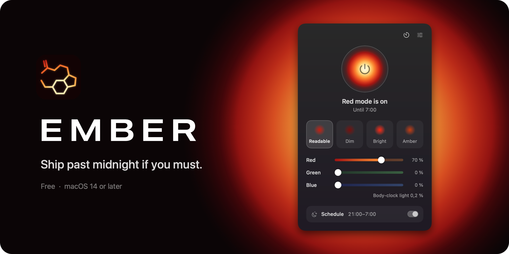

<!-- This page is published from Ember's private repository by the release workflow. Edit it there, in public/README.md. -->

  

  <a href="https://github.com/michaelsamjatin/Ember/releases/latest/download/Ember.dmg"><strong>Download Ember for macOS</strong></a>
  &nbsp;·&nbsp; macOS 14 or later &nbsp;·&nbsp; free

# Ember

A menu bar app that turns your whole screen deep red at night. Not "warm" like Night Shift: green and blue are switched off completely, so the light your body clock reacts to drops close to zero.

## Install

1. [Download Ember.dmg](https://github.com/michaelsamjatin/Ember/releases/latest/download/Ember.dmg), open it and drag Ember into Applications.
2. Ember is not notarized yet. The first time, right-click Ember and choose Open, or allow it under System Settings → Privacy & Security → Open Anyway.
3. Ember lives in the menu bar. If your menu bar is full, macOS hides its icon behind the notch; Ember then drops its panel down from under the notch, and opening Ember again always brings it back.

## Use

- Click the menu bar icon and press the glowing ember to switch red mode on. Option-click the icon toggles it without opening the panel, scrolling over the icon dims or brightens, and ⌃⌥⌘R toggles from anywhere.
- Pick a look (Readable, the default, keeps the full effect with clearer text and Dark Mode; Dim, Bright and Amber cover the rest) or drag the red, green and blue bars yourself. A live estimate shows how much of the light still reaches your body clock.
- Turn on Schedule to have red mode come on by itself, at set times (21:00–07:00 by default) or from sunset to sunrise, easing in over 30 minutes, or use the timer for an hour or two. The sliders icon opens Adjust for the spectrum, clarity, schedule, fade, shortcut and launch at login.
- Add apps under "Pause in these apps" and red mode lifts while one of them is in front, for photo and video work.
- Automate it: add Ember as a Focus filter (System Settings → Focus → Sleep → Focus filters), use the Turn On, Turn Off and Toggle actions in Shortcuts, or open `ember://on`, `ember://on?minutes=30`, `ember://off` or `ember://toggle` from scripts.
- Under "While red mode is on", Flicker-free runs the backlight at full power and dims the picture instead, since backlights pulse most when dimmed, and Anti-dithering stops the graphics chip from flickering pixels between shades.

## Why red

Your body clock reads light mainly through melanopsin, a pigment in the eye that is most sensitive to blue-cyan light and barely responds to deep red. Warm filters like Night Shift still leave lots of green, which melanopsin does respond to. Ember switches green and blue off completely and dims the red, so the light your clock reacts to drops close to zero. It is not a medical device, and room lighting matters too; see [docs/science.md](docs/science.md) for details and sources.

## Feedback

Found a bug or missing something? [Open an issue](https://github.com/michaelsamjatin/Ember/issues). What changed in each version is on the [releases page](https://github.com/michaelsamjatin/Ember/releases).

Ember is free to download and use.
